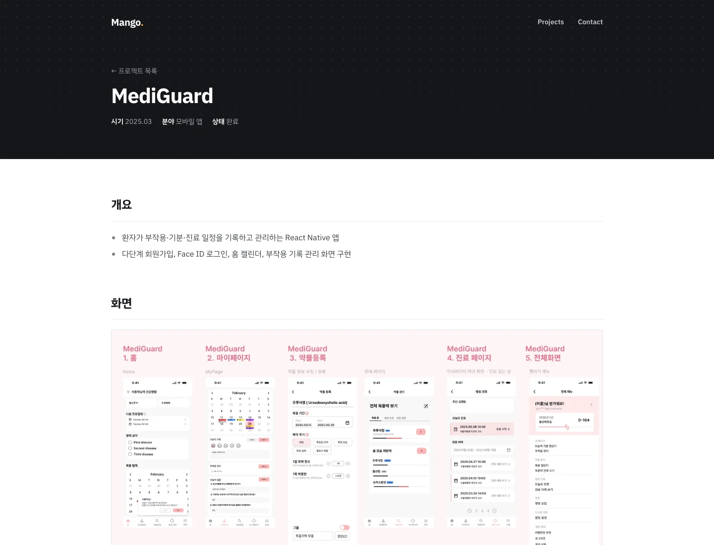

# 송민교 포트폴리오

동국대학교 정보통신공학과 송민교의 개발 포트폴리오 사이트입니다.

**사이트** · https://mango-portfolio-lake.vercel.app


## 프로젝트

| 기간 | 프로젝트 | 내용 |
|---|---|---|
| 2026.07 ~ | 업무 자동화 & 사내 서비스 | 현장실습. CS·A/S 관리 웹, AI 불량유형 분류, 매출 자동 등록, 크롬 확장 |
| 2026.04 ~ 10 | RoomLog | LiDAR 3D 스캔으로 입주·퇴거 방 하자를 비교하는 iOS 앱, 한이음 드림업 동상, [App Store](https://apps.apple.com/kr/app/id6819330161) |
| 2026.04 ~ 06 | PeakTime | 24절기 제철 미션과 기록 iOS 앱 (SwiftUI · TCA), 디프만 18기 |
| 2025.03 | MediGuard | 부작용·기분·진료 일정을 기록하는 환자용 앱 (React Native), 한이음 드림업 장려상 |
| 2025.01 ~ | PlanVas | 성장·휴식 목표 비율을 정하는 iOS 앱 (SwiftUI), UMC 9기 |
| 2023 | CSS (Children Safety System) | 부엌 아동 사고를 막는 IoT 안전 시스템, 교내 장려상 |



## 구성

```
index.html        메인
projects/         프로젝트 상세 페이지
images/           화면 캡처
style.css         공통 스타일
```

## 기술

- HTML, CSS (프레임워크 없음)
- Vercel 배포, `main` 브랜치에 push하면 자동 배포
